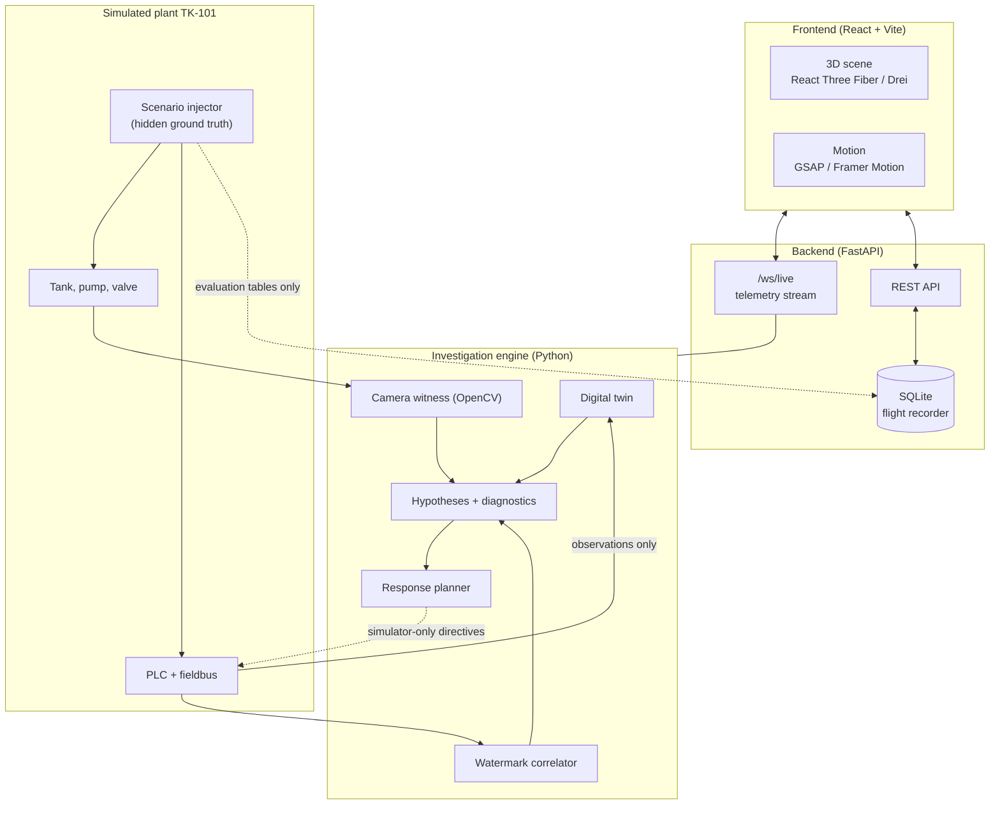

<div align="center">

# 🌊 PhysTrace

**A local-first investigation workstation for cyber-physical incidents.**

*Was it a sensor glitch, a failing valve, or an attack? PhysTrace checks plant telemetry against a physics model, an independent camera witness and an actuator watermark, then shows which explanation the evidence supports and what is still missing.*

[](https://react.dev)
[](https://fastapi.tiangolo.com)
[](https://sqlite.org)

</div>

---

## Overview

Dashboards only show what the sensors *say*. PhysTrace treats every reading as a claim and tests it against other evidence.

It runs a simulated water-treatment tank (**TK-101**): an inflow pump, an outlet valve, level and flow sensors, a PLC and a fieldbus. You inject faults or attacks into that simulator. A defender, which never sees the hidden scenario labels, then has to work out what happened.

> **Safety boundary.** All attacks and responses run inside the local simulator only. PhysTrace does not scan networks and never sends commands to real PLCs or equipment.

## What it does

| Capability | How |
|---|---|
| **Digital twin** | RK4 tank model with a gated, budget-limited state correction. Residuals between prediction and sensors become evidence. |
| **Physical watermark** | A small, seeded ±ε dither on the actuator command. Robust (MAD-based) lagged correlation checks that each sensor still "feels" it. A replayed or spoofed signal loses the watermark. |
| **Virtual witness (camera)** | OpenCV waterline detection on a live camera, a replayed video, or a clearly labelled simulated feed. The source is chosen explicitly and never silently swapped. Blur, exposure, frozen-frame and occlusion checks are included. |
| **Hypothesis engine** | Ranks 7 explanations (sensor spoofing, sensor failure, comms manipulation/delay, controller manipulation, actuator fault, legitimate disturbance, twin mismatch) plus an explicit **INCONCLUSIVE** state. Correlated evidence from one data stream is not double-counted. |
| **Diagnostics** | 8 active tests (direct field read, redundant sensor poll, watermark burst, PLC register check, …) ranked by expected information gain. Each result becomes a new observation, and the scores are recomputed. |
| **Response planner** | Minimax over the top hypotheses with a 300 s simulated horizon, inside a safety layer. |
| **Counterfactuals & ablation** | Lockstep A/B replays ("what if we had isolated the link?") and an ablation of residual-only, watermark-only, fusion and full detectors. |
| **Flight recorder** | SQLite timeline, observations and reports with JSON/CSV export. Ground truth is stored in separate evaluation tables. |

### Honesty rules built into the system

- Scores are **Evidence Scores**, not probabilities. They are not calibrated.
- Temporal order is not treated as causality.
- Provenance stays separate: *Sensor Observation*, *Camera Visual Estimate*, *Digital-Twin Prediction*, *Inference* and *Simulation Ground Truth*.
- Simulation ground truth is used only for evaluation. A test checks that it never reaches inference.
- No hard-coded or fake live metrics. When the backend is offline, the UI says so.

## Architecture



## Repository layout

```
backend/
  phystrace/
    sim/          plant model, scenarios (20 types), PLC, fieldbus, safety layer
    camera/       renderer, frame analysis, live/replay/simulated sources
    inference/    twin, watermark, features, hypotheses, diagnostics, causal graph
    response/     safety-constrained response planner
    evaluation/   harness, metrics, counterfactuals, ablation, reports
    persistence/  SQLite writer
    api/          FastAPI app (REST + WebSocket)
  tests/          acceptance tests (AT-xxx)
frontend/
  src/            landing page, investigation, digital twin, watermark,
                  response planner, flight recorder views
```

## Getting started

**Requirements:** Python 3.11+ and Node 18+.

### Backend

```bash
cd backend
pip install -r requirements.txt
python -m uvicorn phystrace.api.app:app --port 8765
```

Optional environment variables: `PHYSTRACE_DATA` (data directory) and `PHYSTRACE_DB` (SQLite path).

### Frontend

```bash
cd frontend
npm install
npm run dev
```

Open the URL Vite prints (default `http://127.0.0.1:5173`). The UI connects to `ws://127.0.0.1:8765/ws/live`.

### Tests

```bash
cd backend
python -m pytest
```

## Scenario catalogue

| Family | Scenarios |
|---|---|
| Sensor | `SENSOR_BIAS`, `SENSOR_FREEZE`, `SENSOR_REPLAY`, `SENSOR_DRIFT`, `SENSOR_DROPOUT` |
| Communication | `COMM_DELAY`, `COMM_PACKET_DROP`, `COMM_JITTER`, `COMM_STALE_REPLAY`, `COMM_MITM_BIAS` |
| Controller | `CTRL_SETPOINT_OVERRIDE`, `CTRL_GAIN_TAMPER`, `CTRL_LOGIC_BRANCH` |
| Actuator | `VALVE_STUCK`, `VALVE_SLEW_DEGRADED`, `PUMP_TRIP`, `PUMP_CAVITATION` |
| Benign / model | `DEMAND_SURGE`, `INFLOW_FLUCTUATION`, `TWIN_MODEL_MISMATCH` |

Inject one with `POST /api/scenarios`, e.g. `{"type": "SENSOR_REPLAY", "start_in_s": 30}`. The full catalogue is at `GET /api/scenarios/catalog`.

## Key API endpoints

| Method | Path | Purpose |
|---|---|---|
| `GET` | `/api/state` | Current simulator and defender state |
| `POST` | `/api/sim/start` · `pause` · `stop` · `reset` | Simulation control (exactly one loop) |
| `GET` | `/api/hypotheses` · `/api/evidence` | Ranked hypotheses and supporting evidence |
| `GET` / `POST` | `/api/diagnostics` · `/api/diagnostics/{test_id}/run` | Recommended tests and running them |
| `POST` | `/api/responses/evaluate` · `/apply` | Response planning (simulator only) |
| `POST` | `/api/counterfactual` · `/api/ablation` | Experiments |
| `GET` | `/api/runs/{id}/timeline` · `/api/reports/{id}` | Flight recorder and reports |
| `GET` | `/api/export/run/{id}.json` · `.csv` | Export |
| `WS` | `/ws/live` | Live telemetry stream |

## License

No license has been chosen yet. All rights reserved by the author until one is added.
