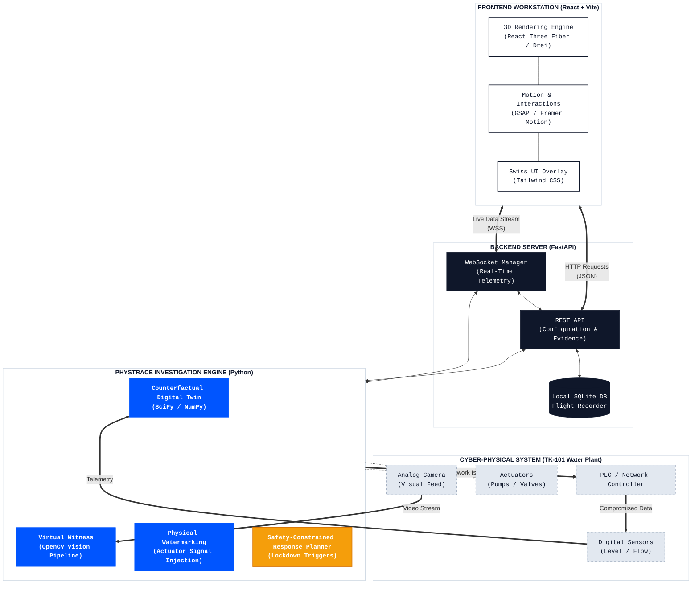

# 🌊 PhysTrace
**The Forensic Black-Box for Cyber-Physical Systems.**

✨ *Stop guessing if it's a sensor glitch or a state-sponsored attack. PhysTrace validates industrial telemetry against the immutable laws of physics.* ✨

 

[View Demo](#) · [Report Bug](#) · [Request Feature](#)

---

## ⚡ Overview: The Ultimate ICS Investigation Engine

Traditional dashboards only tell you what the sensors *claim* is happening. **PhysTrace** is a production-ready, mathematically verified investigation workstation designed for Industrial Control Systems (ICS) and operational technology (OT) environments like water-treatment facilities.

Built with an ultra-premium **Swiss Architectural aesthetic**, seamlessly embedded **3D React UI components**, broadcast-quality **GSAP motion graphics**, and a responsive **WebGL Fluid simulation**, PhysTrace merges a multi-million dollar frontend experience with a mathematically rigorous backend forensic engine.

---

## 🏗️ System Architecture

